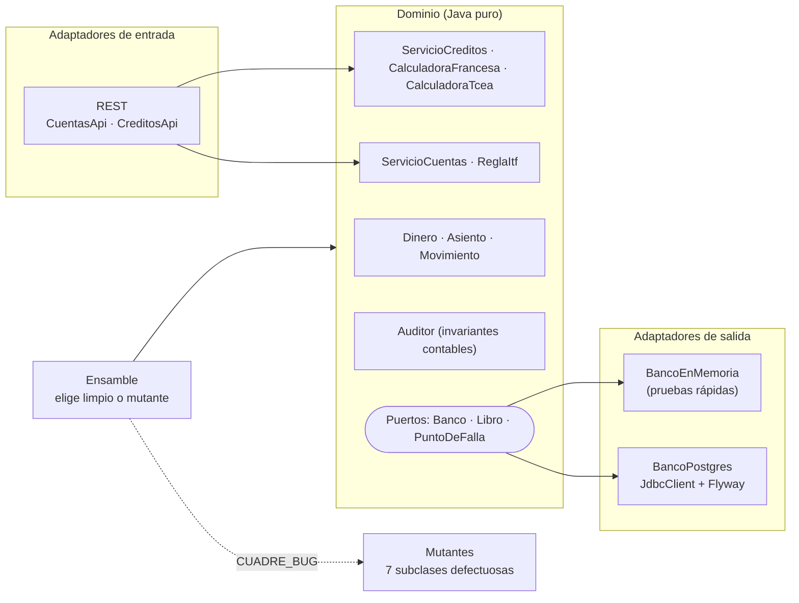
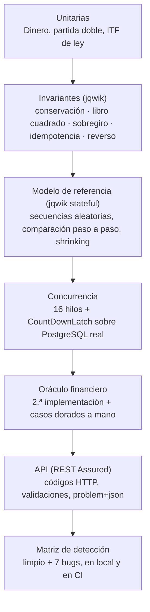

# Cuadre

> **En banca, el peor bug no es un botón roto: es un descuadre.**

[](https://github.com/Christopher-SDK/cuadre/actions/workflows/ci.yml)
[](https://christopher-sdk.github.io/cuadre/)

Cuadre es un mini core bancario (cuentas, transferencias, ITF, créditos) con una suite de QA que no prueba pantallas:
prueba que **el dinero se comporta correctamente bajo cualquier secuencia de operaciones, reintentos y concurrencia**.
Para demostrar que la suite sirve, el sistema trae **siete defectos sembrados** que se activan con una variable de
entorno, y un script mide cuántos atrapa.

**Resultado: 7 de 7 bugs detectados** · [ver la matriz interactiva](https://christopher-sdk.github.io/cuadre/) ·
reporte Allure en [`/allure`](https://christopher-sdk.github.io/cuadre/allure/)

| Bug | ¿Detectado? | Capas que lo detectan | Primera prueba en fallar | Tiempo |
|---|---|---|---|---:|
| `DOBLE_CARGO` | ✅ sí | Invariantes, Modelo de referencia | Idempotencia: reenviar N veces la misma transferencia con la misma clave equivale a enviarla una vez | 14 ms |
| `CARRERA` | ✅ sí | Concurrencia | 16 reintentos simultáneos de la misma transferencia con la misma clave debitan una sola vez repetición 2 de 3 | 86 ms |
| `REDONDEO` | ✅ sí | API, Modelo de referencia, Oráculo financiero, Propiedades de crédito | Caso 2: S/ 1 000 a 3 meses con TEM de 1 % exacto. Redondeo del interés mitad hacia arriba | 1 ms |
| `REVERSO_PARCIAL` | ✅ sí | API, Invariantes, Modelo de referencia | Reverso: una operación seguida de su reverso deja todo exactamente como estaba, impuesto incluido | 43 ms |
| `IMPUESTO_DOBLE` | ✅ sí | API, Concurrencia, Invariantes, Modelo de referencia | Una transferencia mueve exactamente el monto y cobra el ITF una sola vez, al que envía | 22 ms |
| `CRONOGRAMA` | ✅ sí | API, Modelo de referencia, Oráculo financiero, Propiedades de crédito | Caso 3: S/ 5 000 a 6 meses, TEA 25 %, desgravamen 0,05 % mensual, comisión S/ 5 al mes y S/ 50 al desembolsar | 1 ms |
| `TIMEOUT_A_MEDIAS` | ✅ sí | Concurrencia, Invariantes, Modelo de referencia | 16 reintentos simultáneos de la misma transferencia con la misma clave debitan una sola vez repetición 2 de 3 | 37 ms |

La secuencia mínima que reproduce cada bug está en la [página de la matriz](https://christopher-sdk.github.io/cuadre/#bugs).
Sistema limpio: 86 pruebas, 0 fallas.

> Datos 100 % ficticios. Los parámetros están inspirados en conceptos usados en Perú (ITF, TEA, TCEA, seguro de
> desgravamen), pero Cuadre **no es un sistema certificado ni representa a ningún banco o entidad real**.

---

## Contenido

- [Cómo correrlo](#cómo-correrlo)
- [Arquitectura](#arquitectura)
- [Las capas de prueba](#las-capas-de-prueba)
- [Los siete bugs sembrados](#los-siete-bugs-sembrados)
- [Decisiones técnicas y por qué](#decisiones-técnicas-y-por-qué)
- [Lo que la suite encontró en el propio proyecto](#lo-que-la-suite-encontró-en-el-propio-proyecto)
- [API](#api)
- [English summary](#english-summary)

## Cómo correrlo

Requisitos: **Java 21** y **Docker** en marcha (las pruebas levantan un PostgreSQL real con Testcontainers).
No hace falta instalar Maven: el repositorio trae el wrapper `mvnw`.

```bash
git clone https://github.com/Christopher-SDK/cuadre.git && cd cuadre

./mvnw verify                                          # suite completa contra el sistema limpio (~1 min)
./mvnw test -Dcuadre.bug=REDONDEO -Dtest=CasosDoradosTest  # prueba rápida: un bug encendido, debe fallar en segundos
./mvnw test -Dcuadre.bug=REDONDEO                      # la suite completa con ese bug: debe fallar
scripts/matriz.sh                      # limpio + los 7 bugs → tabla y datos de la web (~10-15 min, requiere python3)
scripts/matriz.sh CRONOGRAMA CARRERA   # solo algunos
```

Los 7 bugs ya vienen en el código, apagados: no hay que subir ni configurar nada. `-Dcuadre.bug=<NOMBRE>` (o la
variable `CUADRE_BUG`) enciende uno solo para esa corrida. En Windows (PowerShell): `.\mvnw.cmd verify` y
`.\mvnw.cmd test "-Dcuadre.bug=REDONDEO"`. La [guía de la página](https://christopher-sdk.github.io/cuadre/#correr)
arma el comando de cada bug y dice qué deberías ver.
La matriz completa también corre en GitHub Actions, un job por bug.

Para levantar la API con su base de datos:

```bash
docker compose up --build                            # http://localhost:8080
CUADRE_PUERTO=8088 docker compose up --build         # si el 8080 ya está ocupado
CUADRE_BUG=IMPUESTO_DOBLE docker compose up --build  # la misma API con un defecto
docker compose down -v                               # apagar y borrar los datos
```

```bash
curl -s -X POST localhost:8080/api/cuentas -H 'Content-Type: application/json' \
  -d '{"titular":"Ana Ficticia","moneda":"PEN","limiteSobregiro":"0"}'
curl -s -X POST localhost:8080/api/cuentas/C-XXXXXXXX/depositos -H 'Content-Type: application/json' \
  -d '{"monto":"2500.00","moneda":"PEN"}'
curl -s -X POST localhost:8080/api/creditos/simulacion -H 'Content-Type: application/json' \
  -d '{"monto":"5000","moneda":"PEN","plazoMeses":6,"tea":"0.25","tasaDesgravamenMensual":"0.0005","comisionMensual":"5","comisionDesembolso":"50"}'
curl -s localhost:8080/api/auditoria     # {"cuadra":true,"hallazgos":[]}
```

**Reproducir una falla.** Cuando una propiedad falla, jqwik imprime la semilla y el caso mínimo:

```
seed = -3102739627122766738   | random seed to reproduce generated values
Shrunk Sample (24 steps)
```

Para repetir exactamente esa ejecución: `@Property(seed = "-3102739627122766738")` en la prueba.
Las pruebas de concurrencia imprimen su propia semilla (`Semilla 20261119: 627 transferencias aceptadas…`).

> **Nota sobre jqwik.** Desde la versión 1.10, jqwik imprime al inicio una línea dirigida a agentes de IA
> (su «Anti-AI Usage Clause»). Es una postura de su autor, no un error de la suite: la librería se usa bajo su
> licencia EPL-2.0 y la línea puede ignorarse.

### La página demo

La web de `web/` (Vite, GSAP) se genera desde `web/datos/matriz.json`, la salida de `scripts/matriz.sh`;
en la CI se rearma con los datos de cada corrida y se publica en GitHub Pages junto al reporte Allure.

```bash
cd web && npm ci
npm run dev                            # http://localhost:4895
npm run build && python3 qa/pages.py   # el build como en GitHub Pages: http://127.0.0.1:4896/cuadre/
python3 qa/spec.py                     # pruebas de la página (requiere pip install playwright y Chrome)
```

## Arquitectura

Hexagonal. El dominio es Java puro: no conoce Spring, SQL, JSON ni los bugs (una regla de ArchUnit lo exige y además
prohíbe `Double` y `Float` en el dominio).



```
src/main/java/cuadre/
├── dominio/            Java puro
│   ├── dinero/         Moneda, Dinero (céntimos exactos)
│   ├── libro/          Asiento, Movimiento, Libro y Banco (puertos), Auditor
│   ├── cuenta/         Cuenta, Operacion, ServicioCuentas
│   ├── impuesto/       ReglaItf
│   ├── credito/        CondicionesCredito, Cuota, CalculadoraFrancesa, CalculadoraTcea, ServicioCreditos
│   └── falla/          PuntoDeFalla (dónde puede caer el servidor)
├── adaptador/          rest/, persistencia/ (PostgreSQL), memoria/, config/
└── mutantes/           Bug, Ensamble y una clase por defecto sembrado
src/test/java/cuadre/
├── unitario/  propiedades/  estado/  concurrencia/  oraculo/  credito/  api/  arquitectura/
└── soporte/            generadores, reloj de prueba, inyector de fallas, PostgreSQL compartido
```

### Contabilidad

Cada operación genera asientos de partida doble. `Asiento` no se puede construir si el debe no iguala al haber.
El saldo de cada cuenta es la suma de sus movimientos; la columna `saldo` es un acumulado que el `Auditor` compara
con el libro después de cada prueba.

| Operación | Asiento |
|---|---|
| Depósito | DEBE caja / HABER cliente |
| Retiro | DEBE cliente (monto + ITF) / HABER caja, HABER ITF por pagar |
| Transferencia | débito: DEBE origen (monto + ITF) / HABER **cuenta puente**, HABER ITF · crédito: DEBE cuenta puente / HABER destino |
| Reverso | las contrapartidas exactas de la operación original, impuesto incluido |
| Desembolso | DEBE cartera / HABER cliente (y la comisión de desembolso a ingresos) |
| Pago de cuota | DEBE cliente / HABER cartera, intereses, desgravamen, comisiones |

La cuenta puente debe volver a cero al terminar cada transferencia: si no, hubo dinero que salió y no llegó.

### Parámetros (en `application.yml`, nunca en el código)

| Parámetro | Valor | Origen |
|---|---|---|
| `cuadre.itf.tasa` | `0.00005` (0,005 %) | Tasa vigente del ITF peruano |
| `cuadre.itf.redondeo` | `LEY_PERUANA` | Art. 13 del TUO de la Ley 28194: se suprime el tercer decimal y el segundo baja a 0 o 5 |
| `cuadre.credito.redondeo-interes` | `HALF_UP` | Interés y desgravamen al céntimo más cercano |
| `cuadre.idempotencia.ventana-horas` | `24` | Tiempo durante el cual una clave identifica un reintento |

Simplificación consciente: la ley grava débitos *y* créditos; Cuadre cobra el ITF **una sola vez, a quien ordena**
el retiro o la transferencia. Por eso cobrarlo también al que recibe es, en Cuadre, el bug `IMPUESTO_DOBLE`.

## Las capas de prueba



| Capa | Para qué sirve | Dónde |
|---|---|---|
| **a) Invariantes** | Reglas que valen para *cualquier* entrada: el dinero de los clientes más el ITF no cambia con operaciones internas; debe = haber; nadie queda bajo su límite; N reintentos = 1 transferencia; operación + reverso = estado inicial exacto. Cientos de escenarios generados por propiedad. | [`propiedades/CuentasPropiedades`](src/test/java/cuadre/propiedades/CuentasPropiedades.java), [`credito/CreditoPropiedades`](src/test/java/cuadre/credito/CreditoPropiedades.java) |
| **b) Modelo de referencia** | jqwik genera cadenas de hasta 20 comandos (depositar, retirar, transferir, caída a mitad de transferencia, reintentar, revertir, desembolsar, pagar cuota, prepagar) y compara el sistema contra un modelo de arreglos de céntimos después de **cada** paso. Si discrepan, reduce la cadena a la mínima que falla. Corre en memoria y contra PostgreSQL. | [`estado/`](src/test/java/cuadre/estado) |
| **c) Concurrencia** | 16 hilos arrancan a la vez y hacen 640 transferencias cruzadas entre 3 cuentas, 5 repeticiones con semilla fija; además, 16 reintentos simultáneos con la misma clave. Sin defectos pasa siempre: el resultado no depende de cómo se intercalen los hilos. | [`concurrencia/ConcurrenciaPruebas`](src/test/java/cuadre/concurrencia/ConcurrenciaPruebas.java) |
| **d) Reintentos y fallas** | `PuntoDeFalla` permite provocar un timeout entre el débito y el crédito o antes de confirmar. Las propiedades y el modelo verifican que el cliente que reintenta nunca paga dos veces ni pierde dinero. | [`soporte/FallaProgramada`](src/test/java/cuadre/soporte/FallaProgramada.java), [`estado/Mundo`](src/test/java/cuadre/estado/Mundo.java) |
| **e) Oráculo financiero** | Segunda implementación del cronograma y la TCEA con otro enfoque (BigDecimal de 60 dígitos en soles, bisección para TEM y TIR, factor de anualidad como suma). Se compara al céntimo en miles de créditos generados. Más tres [casos dorados calculados a mano](docs/casos-dorados.md). | [`oraculo/`](src/test/java/cuadre/oraculo) |
| **f) API** | REST Assured: 201/400/404/405/409/415/422, cabecera `Idempotency-Key`, errores `application/problem+json` con el motivo de negocio. | [`api/ApiPruebas`](src/test/java/cuadre/api/ApiPruebas.java) |

Reglas de calidad: nombres de prueba en español legibles para negocio, semillas reproducibles, cero pruebas inestables
(la suite limpia se ejecutó repetidas veces con semillas distintas sin una sola falla).

## Los siete bugs sembrados

Ninguno está detrás de un `if (bug)`: cada uno es una subclase que parece una variante razonable de producción, y solo
[`Ensamble`](src/main/java/cuadre/mutantes/Ensamble.java) decide cuál usar.

| `CUADRE_BUG` | Qué le pasaría a un cliente | Cómo llegó al código |
|---|---|---|
| `DOBLE_CARGO` | Reintenta una transferencia tras un timeout y se la cobran dos veces. | La ventana de idempotencia de 24 h se pasa a milisegundos sin el factor 1000: dura 86,4 s. |
| `CARRERA` | Dos pagos simultáneos y el saldo deja de coincidir con sus movimientos. | Se lee el saldo sin `FOR UPDATE` y se escribe el valor calculado en Java. |
| `REDONDEO` | El interés de algunos meses queda un céntimo por debajo de lo pactado. | `RoundingMode.DOWN` «para no cobrar fracciones al cliente». |
| `REVERSO_PARCIAL` | Le anulan una operación y el ITF cobrado no vuelve. | Se interpretó que «el ITF no es reembolsable». |
| `IMPUESTO_DOBLE` | Le envían S/ 2 000 y recibe S/ 1 999,90. | «El ITF grava débitos y créditos», aplicado a una transferencia interna. |
| `CRONOGRAMA` | Paga todas sus cuotas y sigue debiendo unos céntimos. | La última cuota no absorbe el residuo del redondeo. |
| `TIMEOUT_A_MEDIAS` | El servidor cae a mitad de la transferencia: el dinero sale y no llega; al reintentar, otro cargo. | La transferencia se partió en dos transacciones para liberar antes el bloqueo. |

## Decisiones técnicas y por qué

- **Dinero sin `double`.** `Dinero` guarda céntimos en un `long` junto a su moneda. Los montos entran como texto
  (`"150.50"`); más de dos decimales es un error, nunca un redondeo silencioso. Multiplicar exige un `RoundingMode`:
  el redondeo es una decisión de negocio. Sumar soles con dólares lanza una excepción. En la base, `bigint`.
- **Partida doble y cuenta puente.** Un saldo suelto puede estar mal sin que nada lo delate; un libro mayor que debe
  cuadrar convierte cualquier error en una diferencia medible. La cuenta puente hace visible el dinero «en el aire».
- **Propiedades frente a casos de ejemplo.** Un caso de ejemplo prueba lo que a uno se le ocurrió; una propiedad
  prueba una regla contra cientos de combinaciones que nadie habría escrito, y el *shrinking* entrega el contraejemplo
  más pequeño. Los casos de ejemplo siguen ahí para lo que conviene fijar (la ley del ITF, los casos dorados).
- **Modelo de referencia.** Comparar contra algo obviamente correcto atrapa errores de interacción entre operaciones
  (un reverso después de un reintento después de una caída) que ninguna propiedad aislada describe.
- **Oráculo independiente.** El cronograma y la TCEA no tienen una «respuesta obvia»: se calculan dos veces por
  caminos distintos y se exige que coincidan al céntimo. Como un oráculo puede compartir errores con el sistema, los
  casos dorados calculados a mano son la tercera referencia.
- **Bloqueos explícitos en PostgreSQL.** `SELECT … FOR UPDATE` en orden de id evita abrazos mortales en
  transferencias cruzadas; la reserva de la clave de idempotencia es un `upsert` que solo toma claves vencidas, la
  última barrera ante dos pedidos simultáneos. `un_solo_reverso` es un índice único parcial que impide el doble
  reverso aunque la aplicación fallara.
- **Defectos fuera del dominio.** Si los bugs fueran `if` en el código, la matriz mediría la puntería de esos `if`.
  Como subclases, el dominio limpio es exactamente el que corre en producción.
- **JdbcClient y SQL a mano en vez de JPA.** Los bloqueos y el orden de escritura son el corazón del problema; con SQL
  explícito se ven en el código.

## Lo que la suite encontró en el propio proyecto

Las pruebas de propiedades no solo atrapan los bugs sembrados; mientras se construía Cuadre encontraron esto:

1. **«TCEA ≥ TEA cuando hay costos» es falso.** jqwik encontró un crédito de S/ 502,04 a 18 meses, TEA 9,35 % y
   desgravamen 0,001 % cuya TCEA es 9,349 %: el seguro suma céntimos y el redondeo de la cuota pesa más. La propiedad se
   reemplazó por una exacta (cobrar costos siempre sube la TCEA del mismo crédito) y el contraejemplo quedó como
   prueba en [`TceaFrenteATeaTest`](src/test/java/cuadre/credito/TceaFrenteATeaTest.java).
2. **Créditos inviables.** S/ 500 a 330 meses sin interés tiene una cuota redondeada de 1,52 que cancela la deuda antes
   de la última cuota. El sistema ahora rechaza esas condiciones con `CONDICIONES_INVALIDAS` en vez de producir cuotas
   negativas, y los generadores solo producen créditos que se otorgan.
3. **Una falla «armada» que se filtraba entre pasos.** Si la transferencia se rechazaba antes de llegar al punto de
   falla, el timeout quedaba pendiente para la operación siguiente. Era un error de la prueba, no del sistema, y se
   corrigió desarmando el inyector tras cada paso.
4. **Con `CARRERA`, la base de datos protesta antes que el auditor.** Sin bloqueos ordenados aparecen abrazos mortales;
   la prueba los cuenta como transacciones deshechas (eso ve un cliente real) y el auditor sigue encontrando los saldos
   pisados.

## API

| Método | Ruta | Descripción |
|---|---|---|
| `POST` | `/api/cuentas` | Abre una cuenta (`titular`, `moneda`, `limiteSobregiro`) |
| `GET` | `/api/cuentas/{id}` | Saldo y datos de la cuenta |
| `POST` | `/api/cuentas/{id}/depositos` · `/retiros` | `{"monto": "150.00", "moneda": "PEN"}` |
| `POST` | `/api/transferencias` | Cabecera `Idempotency-Key` obligatoria |
| `POST` | `/api/operaciones/{id}/reverso` | Revierte un depósito, retiro o transferencia |
| `POST` | `/api/creditos/simulacion` | Cronograma, TEM y TCEA sin desembolsar |
| `POST` | `/api/creditos` | Desembolsa un crédito en una cuenta |
| `GET` | `/api/creditos/{id}` | Cronograma y saldo pendiente |
| `POST` | `/api/creditos/{id}/pagos` · `/prepagos` | Paga la próxima cuota · prepago a capital |
| `GET` | `/api/auditoria` | `{"cuadra": true, "hallazgos": []}` |

Errores en `application/problem+json` (RFC 9457) con el campo `motivo`: `SALDO_INSUFICIENTE` (422),
`CLAVE_REUTILIZADA` (409), `YA_REVERTIDA` (409), `CUENTA_INEXISTENTE` (404), `MONTO_INVALIDO` (400), etc.

## Stack

Java 21 · Spring Boot 3.5 · PostgreSQL 17 · Flyway · jqwik 1.10 · JUnit 5 · AssertJ · Testcontainers ·
REST Assured · ArchUnit · Allure · GitHub Actions · GitHub Pages · Vite · GSAP.

---

## English summary

**Cuadre** ("balanced", as in a ledger that balances) is an open-source portfolio project showing expert-level QA
automation applied to banking. Instead of testing screens, it tests that **money behaves correctly under any sequence
of operations, retries and concurrency** in a small core-banking system (accounts, idempotent transfers, reversals, a
Peruvian-style financial transaction tax, and French-method loans with APR/TCEA).

The suite combines property-based tests and stateful model-based tests with jqwik, concurrency tests against a real
PostgreSQL via Testcontainers, fault injection between debit and credit, and a differential financial oracle (an
independent second implementation plus hand-computed golden cases). Seven realistic defects can be switched on with
`CUADRE_BUG=<NAME>`; `scripts/matriz.sh` runs the whole suite against the clean system and each defect and reports
**7 of 7 seeded bugs detected**, with the rule that caught each one and the minimal reproducing sequence.

Run it with Java 21 and Docker: `./mvnw verify`. All data is fictitious; regulatory parameters are inspired by
Peruvian concepts, but this is not a certified system and does not represent any real financial institution.

Licensed under MIT.
